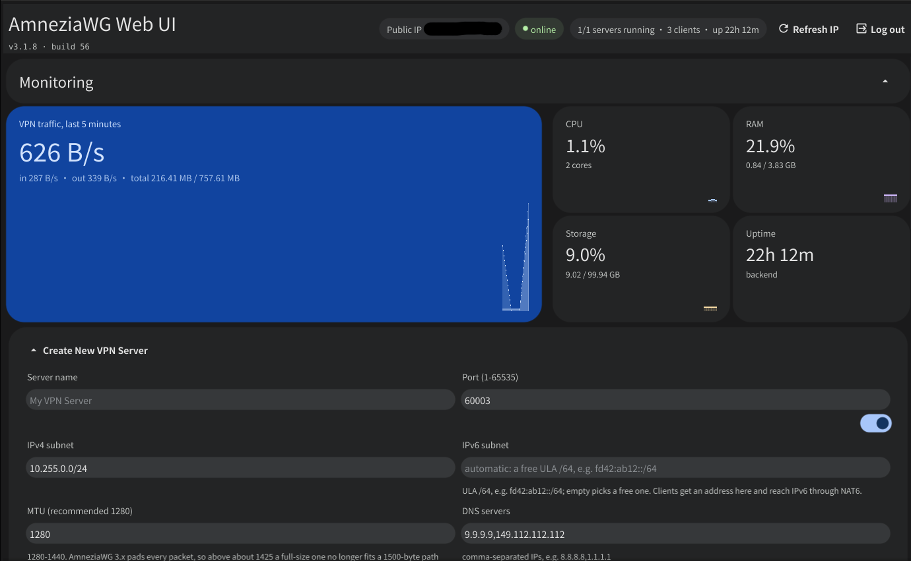

# AmneziaWG Web UI

A self-hosted web panel for **AmneziaWG** — the obfuscated, DPI-resistant fork
of WireGuard. It is one Go/Fiber binary: create several AmneziaWG servers,
manage their clients and watch traffic from a single web interface, where
**AmneziaWG 3.1 (header protection + random trailers) is the built-in,
always-on obfuscation mode**.

All server configuration happens through the web interface or the REST API.
The environment variables given at container start mostly set only *defaults* —
almost everything can be overridden per request and per server through the UI
or the API, with the exception of `WEB_UI_PORT`.

<p align="center">
  
</p>

## 🔒 AmneziaWG 3.1 — the essentials

This is the project's key property: **every server created here uses the full
AmneziaWG 3.x parameter set** — the old "basic obfuscation" 1.0/1.5/2.0 mode is
gone, there is nothing to switch on or off, it is always active.

AmneziaWG 3.0 adds **header protection** on top of the junk-packet and padding
obfuscation of the earlier AmneziaWG generations: the 16-byte WireGuard packet
header (message type, receiver index, counter) — the part that stayed in the
clear even with 1.0/1.5/2.0 obfuscation — is encrypted with ChaCha20 under a
key (`HeaderProtectionKey`) shared by the server and the client. That removes
one of the last low-entropy, DPI-friendly signatures that WireGuard-based
protocols leave on the wire.

What the application does for you automatically:

*   Generates a fresh random 32-byte `HeaderProtectionKey` for every new server
    (unless you supply your own).
*   Honours the one hard requirement of the protocol: the padding values
    `S1`-`S4` must be **≥ 12 bytes**, because the 12-byte nonce of the header
    protection cipher comes from the start of that padding. The application
    checks this on the server side and refuses to create a server that breaks
    it.
*   Keeps the `HeaderProtectionKey` and every obfuscation parameter in sync
    between the server and each generated client config — nothing to copy by
    hand.
*   Turns on both AmneziaWG 3.1 packet-shaping switches, `RandomTrailers` and
    `DisableCookies`, for every new server and writes them into the matching
    client configs (see below — these two must agree on both sides).
*   Exposes the new optional AmneziaWG 3.0 "client-side" timing parameters
    (`ContentPaddingAddition`, `RekeyAfterTime`, `RekeyTimeout`,
    `RejectAfterTime`, `KeepaliveTimeout`, `MaxHandshakeAttempts`,
    `PersistentKeepalive`), so jitter can be added to the handshake and
    keepalive timings and to the content padding — otherwise those are
    WireGuard's constant, predictable timers. The full reference, the engine
    defaults and the recommended ranges are in the
    [Obfuscation parameters](#-obfuscation-parameters) section.

### What AmneziaWG 3.1 adds

3.1 is a small follow-up release on top of 3.0: two new switches in the
`[Interface]` section, the existing parameters are unchanged:

*   **`RandomTrailers`** — appends a random number of bytes to the end of every
    packet, guided by the peer's "UDP window", which the engine derives from
    traffic that already passed. Handshake messages, whose length used to be
    fixed and therefore fingerprintable even in 3.0, no longer have a constant
    size on the wire.
*   **`DisableCookies`** — the interface never answers with a cookie reply and
    skips the MAC2 check under load entirely, so the cookie exchange disappears
    as a signature (and as a surface for reflection attacks).

**`RandomTrailers` is the one obfuscation setting that must match on both
sides.** The receiver accepts an oversized handshake only when the flag is on
for it as well, so a mismatch makes every handshake fail — silently, because
the packet simply fits no known shape and is dropped without a log line.
`DisableCookies`, although it sits next to it, is purely local: the engine
reads it in exactly one place — the "under load" branch on the receiving side —
so it can be turned on at the server without touching the clients.

The application writes both flags from the same stored values into the server
config, into every client `.conf` and into the `vpn://` link, so they stay
consistent — but a client older than AmneziaWG 3.1 (AmneziaVPN < 5.0.1.5)
does not know these keys at all. Clear both checkboxes in the create-server
form if such clients have to be supported. Existing servers are unaffected:
their stored parameters have no flags, and the absence of a flag means "off".

## 🚀 Features

*   **Web management**: a clear interface for managing VPN servers and clients
*   **AmneziaWG 3.1 by default**: header protection, random trailers, disabled cookies, junk packets, message padding and header obfuscation are always fully configured — see above
*   **Client management**: generate and download client configs, suspend and reactivate a client on a running server, suspend on a schedule
*   **Monitoring**: server status, traffic and connections refresh automatically by polling the REST API
*   **Auto-start**: servers come up automatically when the container restarts
*   **iptables automation**: firewall rules without manual work
*   **Your own values**: MTU, subnet, port, DNS, endpoint and any AmneziaWG 3.x obfuscation parameter are configurable per server
*   **QR code**: a client config can be viewed, copied and downloaded as text, as a `.conf` file or as a QR code
*   **Native AmneziaVPN link**: export a client config as a `vpn://…` link that the official app recognises as AmneziaWG 3.x
*   **Config viewer**: both server and client configs open straight from the UI
*   **Client data**: traffic, the last handshake and the IP endpoint are shown and refresh automatically
*   **IPv4 and IPv6 (NAT6)**: every server gets its own ULA `/64` (`fd42:…::/64`), the server takes the first address in it and clients the next ones; client configs carry addresses on both stacks, and `ip6tables` publishes IPv6 traffic outwards through NAT66. More in [IPv6 and NAT6](#-ipv6-and-nat6)

## 🌐 IPv6 and NAT6

AmneziaWG (like WireGuard) is a dual-stack protocol, and a client's default
`AllowedIPs` is `0.0.0.0/0, ::/0`. As long as the tunnel had an IPv4 address
only, `::/0` went into the tunnel and vanished there: IPv6 on the internet did
not work at all. Now every server and every client gets an IPv6 address
automatically.

*   **Subnet**: an RFC 4193 ULA block, a `/64` per server, by default
    `fd42:<server ID>::/64` — the address says which server it belongs to. A
    taken group moves on to the next one, so two servers on one host never
    overlap. Only ULA blocks (`fc00::/7`) are accepted: the panel does not
    touch the host's public prefix.
*   **Addresses**: the server takes the first address of the subnet
    (`fd42:ab12::1`), clients the ones after it (`::2`, `::3`, …). A deleted
    client's address returns to the pool.
*   **`.conf`**: the `Address` line carries both addresses —
    `Address = 10.0.0.1/24, fd42:ab12::1/64` on the server and
    `Address = 10.0.0.2/32, fd42:ab12::2/128` on the client; in the server
    config the peer gets `AllowedIPs = 10.0.0.2/32, fd42:ab12::2/128`.
*   **NAT6**: when a server starts, `scripts/setup_iptables.sh` writes the same
    rule set into `ip6tables`, including
    `ip6tables -t nat -A POSTROUTING -s <subnet> -o eth+ -j MASQUERADE`.
    Check it with `GET /api/system/iptables-test?server_id=…`: for a server
    with an IPv6 subnet the three `ip6tables` rules appear there, plus two
    routing checks — an IPv6 default route and a global IPv6 address — without
    which the NAT66 rule has nothing to masquerade onto.
*   **What the host needs**: IPv6 enabled and forwarding on —
    `net.ipv6.conf.all.disable_ipv6=0`, `net.ipv6.conf.all.forwarding=1`,
    `net.ipv6.conf.default.forwarding=1` (already in `docker-compose.yml`) —
    plus the `ip6table_nat` module for NAT66. Without `ip6tables` the server
    still comes up, but NAT6 does not work — visible in `iptables-test`.
*   **The uplink is read, not assumed**: both scripts used to match `-o eth+`,
    which is the container's bridge interface. On a host-network deployment,
    or any host whose uplink is called something else, the masquerade and
    forwarding rules matched nothing and no client reached the internet — on
    either stack. They now resolve the interface per family from
    `ip route show default` and `ip -6 route show default`, and print what is
    missing when there is no default route at all.
*   **What the container needs for IPv6 egress**: an IPv6 address and a
  default route of its own. A container on the default bridge has neither —
  publishing the port makes the tunnel *reachable* over IPv6 (Docker proxies
  the host's IPv6 port to the container's IPv4 one) but leaves the container
  itself without a v6 uplink, so clients' `::/0` traffic dies at the
  masquerade. Either run the service with `network_mode: host` (then
  `WEB_UI_PORT`/`DEFAULT_PORT` are the host's ports and the two
  `net.ipv6.conf.*` sysctls belong on the host) or give the Docker network an
  IPv6 subnet and a routed global prefix of your own. `iptables-test` reports
  whether an IPv6 default route and a global IPv6 address exist, which is the
  quickest way to tell the two situations apart.
*   **Reaching the panel over IPv6**: the listener is dual-stack (`tcp`), so
  `http://[2001:db8::1]:54845` answers exactly like the IPv4 address does.
*   **Reaching the tunnel over IPv6**: the engine is dual-stack by itself —
  `amneziawg-go` opens a `udp4` and a `udp6` socket on the server's port — so
  the same `[Interface]` answers on whichever family the client reaches it by.
  What has to exist is the path to the container: with the default port
  mapping Docker proxies the host's IPv6 port to the container's IPv4 address,
  which works, and with `network_mode: host` the host's own addresses are used
  directly.
*   **Endpoint**: a client config's `Endpoint` accepts a host name, an IPv4
  address, or an IPv6 literal — with or without the brackets a `.conf` file
  writes it in; the panel stores the address canonically and brackets it when
  it writes the line. A host name with both an `A` and an `AAAA` record is the
  way to let each client pick its own family. A value carrying a port is
  refused: the port is the server's own and is appended by the panel. When the
  field is left empty the panel uses the detected public address, IPv4 first
  and IPv6 for a host that has no IPv4 at all.
*   **DNS on either stack**: `dns` (and `DEFAULT_DNS`) takes IPv4 and IPv6
  resolvers, comma separated; a name is refused, since it could not be
  resolved before the tunnel is up. A client on an IPv6-only network needs a
  v6 resolver — `8.8.8.8` is simply not routable there.
*   **Your own subnet**: the optional `subnet_v6` field of `POST /api/servers`
    and the "IPv6 subnet" row in the advanced form. An empty value means "pick
    a free `/64` yourself".
*   **Upgrading**: `web_config.json` is brought to schema version 5 by a
    migration — existing servers and clients get addresses — and the panel
    appends the addresses to the `.conf` files on startup (the `Address` line
    and the peers' `AllowedIPs`), so servers do not have to be recreated.

## 🏗️ Architecture

### Components

**Go/Fiber backend** (`main.go`, `internal/`)

*   `main.go` — assembly only: reads the environment, brings up the manager, the
    Fiber app, the login guard (`internal/auth`), the REST routes and the
    frontend served from `./web-ui/wasm`, listens on `WEB_UI_PORT`
*   `internal/httpapi` — REST API route handlers: request decoding and turning
    the manager's typed errors into status codes. It touches neither the disk
    nor the host
*   `internal/manager` — business logic: the server and client lifecycle,
    suspension, traffic, interface status. The only owner of the config lock;
    split by file: `servers.go`, `clients.go`, `suspend.go`, `status.go`,
    `traffic.go`, `system.go`
*   `internal/awg` — the only place that shells out: `awg`, `awg-quick`,
    `ip link`, the iptables scripts — behind the `Runner` interface, which the
    tests replace with the fake from `awg/awgtest`
*   `internal/wgconf` — the `.conf` text: rendering the `[Interface]` and the
    client config (one shared AmneziaWG 3.x parameter block for both sides),
    peer-block markers, suspended blocks, the default I1–I5
*   `internal/amnezialink` — `vpn://` export in AmneziaVPN's native format
*   `internal/store` — reading and atomically writing `web_config.json` and the
    one-shot schema migrations (`migrations.go`)
*   `internal/config` — environment variables → `Settings`; the only place with
    `os.Getenv`
*   `internal/auth` — the way into the panel: the credential check (constant
    time, against `WEB_UI_USER` / `WEB_UI_PASSWORD`), the signed session cookie,
    the login page embedded from `internal/auth/login.html` and the middleware
    that lets `/status`, `/login` and `/logout` through and answers everything
    else — see [Security](#security)
*   `internal/frontend` — serving the frontend off disk: the gzip bundle, the
    loading page repainted for the panel's dark palette, ETag validators (so the
    browser neither keeps a stale bundle after an update nor re-downloads ~50 MB
    of wasm on every load), response compression
*   `internal/publicip`, `internal/netutil`, `internal/atomicfile` — small
    helper packages: public address detection, subnet arithmetic, atomic file
    writes
*   No reverse proxy and no supervisor: the single compiled binary
    (`/usr/bin/api` in the container) does everything, and
    [`tini`](https://github.com/krallin/tini) runs as PID 1 only to reap
    orphaned child processes

**Fyne frontend** (`web-ui/`, its own Go module)

*   A [Fyne](https://fyne.io) application compiled to WebAssembly — no
    JavaScript frameworks and no npm; `make web-ui` packages it into
    `web-ui/wasm`, from where the server serves the files straight off disk —
    nothing is embedded into the binary, so the bundle can be replaced without
    rebuilding the server
*   A single dark theme, forced inside the application itself. The loading page
    `fyne package` writes is served by `internal/frontend`, which pins it to the
    dark branch (its two stylesheets and its two spinners are otherwise chosen
    by `prefers-color-scheme`) and paints it in the panel's own `#131314`: a
    browser set to light would otherwise show a white page, with a spinner
    drawn for one, between the login and the panel
*   Status and traffic refresh by REST polling: the counters every 5 seconds
    with one `GET /api/traffic` request, the server list every 30 seconds (and
    right after every action from that tab). No sockets: a wasm build has no
    TCP stack, and the browser hands you `fetch` for free, the session cookie
    included
*   All request and response structs live in `web-ui/api`. The backend imports
    the same package through a `replace` directive, so the two sides cannot
    drift apart
*   The AmneziaWG rules live in `web-ui/api` next to the types they describe:
    the limits, `Validate` for an obfuscation parameter set, `ValidateCPS` for
    `I1`-`I5`, `GenerateObfuscation`. The form and the backend call the same
    copy, so "the form let it through, the server refused" cannot happen; the
    backend keeps thin wrappers that reduce the list of problems to one error.
    The field captions carry the recommended values, the placeholders the
    accepted range

### Directory layout

```
.
├── main.go                    # Entry point: wiring the dependencies and the Fiber app
├── internal/
│   ├── httpapi/               # REST API route handlers
│   ├── manager/               # Server/client lifecycle, status, traffic
│   ├── awg/                   # Every shell command behind the Runner interface (+ awgtest)
│   ├── wgconf/                # Rendering and editing .conf, peer blocks, I-settings
│   ├── amnezialink/           # vpn:// export for AmneziaVPN
│   ├── store/                 # web_config.json: loading, atomic writes, migrations
│   ├── config/                # Environment variables → Settings
│   ├── frontend/              # Serving the frontend: gzip bundle, ETag
│   ├── publicip/              # Public address detection
│   ├── sysinfo/               # CPU, memory and disk readings of the host
│   ├── netutil/               # Subnet arithmetic
│   └── atomicfile/            # Atomic file writes
├── web-ui/                    # Fyne frontend, its own Go module
│   ├── FyneApp.toml           # Application metadata for "fyne package"
│   ├── Icon.png               # Application icon
│   ├── api/types.go           # Wire types shared with the backend (through replace)
│   ├── wasm/                  # "fyne package" output: loader page + bundle (generated)
│   ├── main.go                # Application entry: dark theme, window, lifecycle
│   └── internal/ui/           # The application itself
├── AGENTS.md                  # Repository conventions for coding agents
├── e2e/                       # Browser tests on playwright-go, its own Go module (see e2e/README.md)
│   ├── main_test.go           # TestMain (driver, Chrome), coordinate clicks, REST API checks
│   ├── 01_smoke_test.go       # Page load, login, canvas rendering
│   ├── 02_create_test.go      # Creating a server through the UI
│   ├── 03_client_test.go      # Adding a client
│   ├── 04_config_test.go      # Viewing configs and the QR code
│   ├── 05_polling_test.go     # Traffic polling keeps going
│   └── 06_port_test.go        # A taken port is rejected by the form
├── scripts/
│   ├── start.sh               # Container entry point (started through tini)
│   ├── setup_iptables.sh
│   └── cleanup_iptables.sh
├── .github/workflows/docker.yaml # CI: building and publishing the image
├── Dockerfile                 # Multi-stage build: the Go binary + pinned amneziawg-go and amneziawg-tools
├── docker-compose.yml         # Base compose file (runs the ready image, no build)
├── docker-compose.build.yml   # Overlay that adds `build: .` (used by `make run`)
└── Makefile
```

## 🔨 Building and running locally

Go 1.26+ is required. The frontend bundle is built by `make web-ui` (or
`make build`, which calls it first) — the `fyne` packaging tool is declared as a
`tool` dependency of the `web-ui` module, so it does not have to be installed
separately.

```bash
make help          # every target with its description
make build         # make web-ui + go build -o server.bin . — a build without docker
make build-server  # the binary only; it serves the bundle already in web-ui/wasm
make web-ui        # rebuild only the WebAssembly bundle into web-ui/wasm
make vet           # go vet ./... over every module (web-ui under GOOS=js GOARCH=wasm, plus e2e)
make run           # docker compose -f docker-compose.yml -f docker-compose.build.yml up --build
                   # builds the full image from source (the Go binary + amneziawg-go + amneziawg-tools) and runs it
make exec          # a shell inside the running container
make e2e           # bring a clean test instance up and run the browser tests (playwright-go)
make profile-mem   # fetch a heap profile from the running instance and open it in go tool pprof
make profile-cpu   # collect a CPU profile (30 s) and open it in go tool pprof
make deploy        # build the image, save it to proxy.tar and deploy over ssh (the host is asked interactively)
```

`make run` is the simplest way to get a fully working container (with the real
AmneziaWG engine in user space, v3 capable) without installing anything but
Docker. The local run settings live in `.env` (`COMPOSE_PROJECT_NAME`,
`AUTO_START_SERVERS`, `DEFAULT_MTU`, …); whatever is missing falls back to the
defaults — the web UI on `54845/tcp`, the VPN on `54844/udp`, password
`changeme`. The production settings (their own ports and `WEB_UI_PASSWORD`) live
separately in `deploy/.env`: `make deploy` puts exactly that file next to the
`docker-compose.yml` on the server.

### Browser tests

The frontend is a single WebAssembly canvas, so it has no CSS selectors: every
interactive part of the page registers a name (`window.awgTarget`), and the
tests in `e2e` click the centre of the one they mean and check the result
through the REST API, saving a screenshot of every step into `e2e/shots/`. A
widget that grows a row, moves into an overflow menu or changes its column
count cannot silently send a click somewhere else. The last test runs the same
page in a 390-point-wide touch context - phone layout, taps instead of clicks -
and fails if anything reaches past the right edge. They are written in Go on
[playwright-go](https://github.com/mxschmitt/playwright-go) and live in their
own `e2e` module so the dependency stays out of the main `go.mod`. The tests
share one backend and build on each other's state (`02` creates the server that
`03` adds a client to), so `go test` runs them in file order on a single thread,
and they expect an instance with no servers configured. Node.js is not needed:
on the first run `TestMain` downloads the Playwright driver (with its own Node)
into `~/.cache/ms-playwright-go`, and the browser is the Chrome installed on
the machine.

```bash
make e2e
```

`make e2e` brings the backend into that state itself: `make e2e-reset` removes
the container and its volume, rebuilds the image, starts it and waits for
`/status` to answer. The instance is deliberately separate from the one
`make run` leaves behind — its own container `awgui-test`, its own volume
`awgui-test-data`, port `51836` — because wiping state before the tests must not
touch the servers you are working on. It stays up after the run so a failing
test can be inspected; `make e2e-down` removes the container together with the
volume.

These are overridden with Makefile variables: `E2E_PORT`, `E2E_NAME`,
`E2E_VOLUME`, `E2E_URL`, `E2E_TIMEOUT`, `E2E_TEST_TIMEOUT`. Running the tests
against an instance that is already up, without recreating anything, still
works directly:

```bash
cd e2e && AWG_URL=http://localhost:54845 go test -count=1 -v .
```

## 🔧 API endpoints

Every route except `/status`, `/login` and `/logout` needs a session cookie or
an `Authorization: Basic` header (see [Security](#security)). A request that
carries neither and asks for JSON — anything under `/api` or `/debug`, or any
request with `Accept: application/json` — is answered with `401` and
`{"error":"authentication required"}`; a browser navigation is redirected to the
login page instead.

### Server management

#### Create a server

```yaml
POST /api/servers
Content-Type: application/json

{
  "name": "My VPN Server",
  "port": 54844,
  "subnet": "10.0.0.0/24",
  "subnet_v6": "fd42:ab12::/64",
  "mtu": 1280,
  "endpoint": "vpn.example.com",
  "dns": "8.8.8.8,1.1.1.1",
  "obfuscation": true,
  "auto_start": true,
  "obfuscation_params": {
    "Jc": 8,
    "Jmin": 8,
    "Jmax": 80,
    "S1": 50,
    "S2": 60,
    "S3": 20,
    "S4": 16,
    "H1": 1000,
    "H2": 2000,
    "H3": 3000,
    "H4": 4000,
    "MTU": 1280
  }
}
```

`endpoint` and `dns` are optional: without them the detected public IP and
`DEFAULT_DNS` are used. `dns` accepts either a comma separated string or an
array of strings, on either stack (`2606:4700:4700::1111` is a resolver like
any other). `endpoint` is a host on its own — a name, an IPv4 address, or an
IPv6 literal with or without brackets — and a value carrying a port
(`vpn.example.com:54844`) or a scheme answers `400`: the port is the server's
own and is appended to every client config. The same goes for `port`, `subnet` and `mtu`: an omitted
field is `DEFAULT_PORT`, `DEFAULT_SUBNET` and `DEFAULT_MTU`, and the panel's
form starts from those same three plus `DEFAULT_DNS`, which is why they are
worth setting even when every server is created through the UI. `auto_start`
is the odd one out: the form sends it explicitly, from the switch in its
advanced mode - which starts from `AUTO_START_SERVERS` - so that setting is
what a server created in the panel follows.

`subnet_v6` is optional too: an empty value (or a missing field) means "take a
free ULA `/64` of the form `fd42:<server ID>::/64`". The subnet must be a ULA
block (`fc00::/7`) no longer than `/120`; overlapping another server's subnet
answers `409`, a malformed block `400`. The response, like `GET /api/servers`,
carries `subnet_v6` and `server_ipv6`, and a client carries `client_ipv6`.

#### AmneziaWG 3.1 (header protection, random trailers)

There is only one obfuscation mode now: `"obfuscation": true` always enables
the full AmneziaWG 3.x parameter set, header protection included. The old
1.0/1.5/2.0-only modes (and the former `awg2`/`awg3` request flags) are gone.

*   `S1`, `S2`, `S3`, `S4` must be **≥ 12** (the header protection cipher takes
    its 12-byte nonce from the start of that padding); otherwise the server
    rejects the request. The documentation recommends setting all four to the
    same value and leaving `H1`-`H4` at 1/2/3/4 — more in the
    [Obfuscation parameters](#-obfuscation-parameters) section.
*   A 32-byte `HeaderProtectionKey` in base64 is required; it is generated
    automatically if you do not pass one in `obfuscation_params`. It must match
    byte for byte between the server and each of its clients — for the configs
    the application generates, that happens automatically.
*   The optional "client-side" timing parameters (each side applies them to its
    own behaviour, so they do not have to match): `ContentPaddingAddition`,
    `RekeyAfterTime`, `RekeyTimeout`, `RejectAfterTime`, `KeepaliveTimeout`,
    `MaxHandshakeAttempts`, `PersistentKeepalive`. Each takes an integer or an
    `"a-b"` range (for example `"5-10"`); leave it empty to use the engine
    defaults.

    Each of them is stored by `awg(8)` as a pair of `uint16`, so both bounds of
    the range must fit `0-65535`, and the second must not be below the first;
    that is stated in the form's field captions and checked on both the client
    and the server.

    | Parameter | Engine value (unset) | Recommended range |
    |---|---|---|
    | `ContentPaddingAddition` | off (16-byte alignment) | `0-64` |
    | `RekeyAfterTime` | 120 s | `100-140` |
    | `RekeyTimeout` | 5 s | `4-7` |
    | `RejectAfterTime` | 180 s | `160-200` |
    | `KeepaliveTimeout` | 10 s | `8-12` |
    | `MaxHandshakeAttempts` | 18 | `14-20` |
    | `PersistentKeepalive` | 25 s | `22-30` (from the example in `amneziawg-go`'s own README) |

    The "engine value" column is taken straight from `device/constants.go` in
    `amneziawg-go` (WireGuard's standard timing constants).
    An officially documented recommended range exists only for `Jc` (`4-12`)
    and `PersistentKeepalive` (`22-30`) — the rest of the "recommended range"
    column is conservative jitter around the defaults, not an official
    recommendation: AmneziaWG does not publish one.

*   The two AmneziaWG 3.1 packet-shaping switches, `RandomTrailers` and
    `DisableCookies` — plain JSON booleans, both **on** when the server
    generates the parameters itself:

    | Parameter | Type | Default | Notes |
    |---|---|---|---|
    | `RandomTrailers` | bool | `true` | A random "trailer" on every packet; **must match on server and client** |
    | `DisableCookies` | bool | `true` | Never send a cookie reply, skip the MAC2 checks under load |

    Pass `"RandomTrailers": false` (and/or `"DisableCookies": false`) in
    `obfuscation_params` to leave them off. A disabled flag is written as *the
    complete absence of the line* rather than `= off`, because a parser older
    than 3.1 rejects an unknown key outright and would refuse to import the
    config.

```yaml
POST /api/servers
Content-Type: application/json

{
  "name": "My VPN Server (AWG 3.1)",
  "port": 54844,
  "subnet": "10.0.1.0/24",
  "mtu": 1280,
  "obfuscation": true,
  "obfuscation_params": {
    "Jc": 8, "Jmin": 8, "Jmax": 80,
    "S1": 50, "S2": 66, "S3": 20, "S4": 16,
    "H1": 1000, "H2": 2000, "H3": 3000, "H4": 4000,
    "MTU": 1280,
    "ContentPaddingAddition": "0-64",
    "RekeyAfterTime": "100-140",
    "PersistentKeepalive": "22-30",
    "RandomTrailers": true,
    "DisableCookies": true
  }
}
```

> [!NOTE]
> **Moving an already running server**: existing servers keep working
> unchanged — this only touches newly created ones. Rebuild the image
> (`docker compose build` / `make run`) to get the pinned
> `amneziawg-go`/`amneziawg-tools` 3.1 binaries; the new engine reads a 3.0-era
> config exactly as before, and missing `RandomTrailers`/`DisableCookies` keys
> mean "off". Servers created before AmneziaWG 3.0 support existed (without a
> `HeaderProtectionKey` and possibly with `S1`-`S4` below 12) work as they did
> too — nothing rewrites their configuration files automatically. To move such
> a server to AmneziaWG 3.x, recreate it (or edit `web_config.json` and the
> server `.conf` by hand, adding `S1`-`S4` ≥ 12 and a `HeaderProtectionKey`),
> then hand out regenerated client configs — the old ones, without a matching
> `HeaderProtectionKey`, cannot connect once header protection is on at the
> server.

#### List servers

`GET /api/servers`

#### Start a server

`POST /api/servers/{server_id}/start`

#### Stop a server

`POST /api/servers/{server_id}/stop`

#### Delete a server

`DELETE /api/servers/{server_id}`

#### Get a server's configuration

`GET /api/servers/{server_id}/config`

#### Download a server's config

`GET /api/servers/{server_id}/config/download`

#### Server information

`GET /api/servers/{server_id}/info`

#### Traffic

`GET /api/traffic`

The interface and peer counters of every server plus the host readings in one
response — what the frontend polls every 5 seconds:

```json
{
  "timestamp": 1757577600,
  "server_traffic": {
    "<server_id>": { "rx": "1.20 MB", "tx": "3.40 MB", "rx_bytes": 1258291, "tx_bytes": 3565158, "uptime_seconds": 4215 }
  },
  "client_traffic": {
    "<server_id>": {
      "<client_id>": {
        "received": "…", "sent": "…", "last_handshake": "…", "endpoint": "…"
      }
    }
  },
  "system": {
    "cpu": { "cores": 8, "busy_seconds": 1743.9, "total_seconds": 16755.8 },
    "memory": { "total": 36252966912, "used": 10900393984 },
    "storage": { "total": 105689374720, "used": 26422362112 }
  }
}
```

Every value is instantaneous: `rx_bytes`/`tx_bytes` and `cpu` are cumulative
counters since the interface came up and since the system booted, and the panel
derives the rate and the CPU load from the difference between two consecutive
responses. The server and client bytes come from one source,
`awg show <iface> transfer`: the server is the sum over its peers, so its
figure always equals the sum of the client rows (peers written into the `.conf`
outside the panel count in the sum but get no row). Only the page keeps the
5-minute history; the server remembers nothing between requests. `storage` is
the filesystem of the `/etc/amnezia` volume, `memory` is as `free` reports it
(used = total − available). A reading that could not be taken comes back as
zeros.

### Client management

#### Add a client

```yaml
POST /api/servers/{server_id}/clients
Content-Type: application/json
{
  "name": "Alice's Phone",
  "apply_i_settings": false,
  "i_settings": {},
  "allowed_ips": "0.0.0.0/0, ::/0"
}
```

#### List a server's clients

`GET /api/servers/{server_id}/clients`

#### List all clients (across every server)

`GET /api/clients`

#### Delete a client

`DELETE /api/servers/{server_id}/clients/{client_id}`

#### Change a client's AllowedIPs

`PUT /api/servers/{server_id}/clients/{client_id}/allowed-ips`

#### Change a client's I-settings (the I1-I5 signature packets)

`PUT /api/servers/{server_id}/clients/{client_id}/i-settings`

#### Suspend / activate a client (drop the peer on the fly without deleting it)

`POST /api/servers/{server_id}/clients/{client_id}/suspend`
`POST /api/servers/{server_id}/clients/{client_id}/activate`

#### Set a client's auto-suspend time

`PUT /api/servers/{server_id}/clients/{client_id}/suspend-time`

The body is `{"suspend_at": "<ISO 8601>"}` or `{"suspend_at": null}` to clear
the timer.

#### Download a client config as `text/plain` (a .conf file)

`GET /api/servers/{server_id}/clients/{client_id}/config`

#### A client config as text and as QR/JSON at once

`GET /api/servers/{server_id}/clients/{client_id}/config-both`

#### Native AmneziaVPN link (`vpn://…`)

`GET /api/servers/{server_id}/clients/{client_id}/link`

The plain-`.conf` importer in the official `amnezia-client` app always marks an
imported AWG config as the outdated `amnezia-awg` container (shown as
"AmneziaWG 2.0", without header protection) instead of the current
`amnezia-awg2`. This native link carries the `container` and
`protocol_version` fields the app uses to recognise the server as AmneziaWG
3.x. In the UI it is the third tab of the client QR-code dialog.

#### Default I-settings (the I1-I5 values applied under `apply_i_settings`)

`GET /api/default-i-settings`

### System endpoints

#### System status (public IP and the like)

`GET /api/system/status`

#### Refresh the public IP

`GET /api/system/refresh-ip`

#### iptables check

`GET /api/system/iptables-test?server_id=wg_abc123`

Every rule `scripts/setup_iptables.sh` should have left, keyed by the command
that looked for it, with `Found` or `Not found` as the value. Every server also
gets one routing check (`ip route show default`) and a server with an IPv6
subnet three more (`ip -6 route show default`, `ip -6 addr show scope global`):
a NAT rule exists whether or not there is anything behind it to masquerade
onto, and these say which situation the host is in.

#### Health check (no credentials)

`GET /status` — the container uptime; used by the image's `HEALTHCHECK`.

## 📈 Profiling

The server can serve `net/http/pprof` profiles, but only when started with
`WEB_UI_PPROF=1`: collecting a CPU profile costs the running server real time,
and the endpoints themselves hand out goroutine stacks and the process command
line. The routes are registered **after** the login guard, so `/debug/pprof`
needs the same session cookie — or the same basic-auth credentials — as the API.

```bash
# docker compose: add the variable to .env (or to the service's environment)
echo 'WEB_UI_PPROF=1' >> .env && docker compose up -d
```

After that the profile is taken with Makefile targets — they download it into
`profiles/` (a directory in `.gitignore`) and open it in `go tool pprof`:

```bash
make profile-mem                      # current heap (inuse_space), with a GC before the snapshot
make profile-alloc                    # everything allocated since start (alloc_space)
make profile-cpu                      # 30 seconds of CPU; load the server while it collects
make profile-cpu PPROF_SECONDS=60     # a different duration
make profile-clean                    # remove the downloaded profiles
```

Every snapshot lands under its own timestamp (`heap-20260903-141500.pprof`), so
the last two are a "before/after" pair. Compare them:

```bash
make profile-diff                     # the last two heap profiles
make profile-diff PPROF_KIND=cpu      # the last two CPU profiles
make profile-diff PPROF_KIND=alloc    # the last two alloc profiles
```

`profile-diff` subtracts the older snapshot from the newer one
(`go tool pprof -base`) and shows only what changed: growth between two heap
snapshots after GC is a sign of a leak, and a drop after a fix confirms it
worked. The comparison works across different binaries too: samples are matched
by function name, not by address.

The settings are overridden with make variables:

| Variable | Default | Description |
|----------|---------|-------------|
| `PPROF_HOST` | `localhost` | Host of the running instance |
| `PPROF_PORT` | `54845` | Port (that instance's `WEB_UI_PORT`) |
| `PPROF_USER` | `admin` | Login name, sent as `curl -u` |
| `PPROF_PASSWORD` | `changeme` | The password **in plain text**, not the hash from `WEB_UI_PASSWORD` |
| `PPROF_SECONDS` | `30` | How long the CPU profile is collected |
| `PPROF_DIR` | `profiles` | Where the downloaded profiles go |
| `PPROF_KIND` | `heap` | What `profile-diff` compares: `heap`, `cpu` or `alloc` |
| `PPROF_FLAGS` | — | Extra `go tool pprof` flags: `-http=:8081` opens the web UI (needs graphviz), `-top -nodecount=20` just prints the hot spots |

```bash
make profile-mem PPROF_PASSWORD=secret PPROF_FLAGS=-http=:8081
```

The other profiles (`goroutine`, `allocs`, `block`, `mutex`, `trace`) are
available by hand at the same addresses; the index is `GET /debug/pprof/`. Note
that `block` and `mutex` are always empty without
`runtime.SetBlockProfileRate` / `SetMutexProfileFraction`.

## 🐳 Deploying in Docker

CI builds and publishes the image to GitHub Container Registry on every push to
`main` (see `.github/workflows/docker.yaml`). Each build publishes exactly one
tag, `latest`, replacing it in place: the package holds one version instead of
one per release, and a `v*.*.*` tag no longer starts a build or produces
`3.1.10` / `3.1` / `3` images. The image is `ghcr.io/<owner>/<repository>`,
built with the workflow's built-in `GITHUB_TOKEN` — no secret has to be
configured.

A freshly created package is **private**: either make it public once under
*Package settings → Change visibility*, or run `docker login ghcr.io` (with a
token that has `read:packages`) on the machine that pulls it. Or just build the
image locally with `make run` / `docker compose build`.

The image weighs just **~26 MB**: no interpreters, no nginx, no supervisor. For
comparison, [`ghcr.io/w0rng/amnezia-wg-easy:latest`](https://github.com/w0rng/amnezia-wg-easy)
is ~80 MB.

The upstream AmneziaWG versions are pinned in the `Dockerfile`
(`AWG_GO_VERSION=v3.1.20260828`, `AWG_TOOLS_VERSION=v3.1.20260812`), so a
rebuild cannot silently pick up an incompatible or broken commit from `master`.
Both versions must belong to the same AmneziaWG generation. To build with
different tags:

```bash
docker build --build-arg AWG_GO_VERSION=vX.Y.Z --build-arg AWG_TOOLS_VERSION=vX.Y.Z -t awgui .
```

### Environment variables

| Variable | Default | Description |
|----------|---------|-------------|
| `WEB_UI_PORT` | `54845` | Port the application listens on for the web UI. The same default is set in the image's `ENV`, in the binary and in `docker-compose.yml` (where it is also published on the host) |
| `WEB_UI_BIND` | *every address* | Address the panel binds **inside the container**. Unset means `[::]` with `v6only` off, one listener for both stacks. With published ports this has to stay unset — Docker forwards to the container's address, not to its loopback — and the restriction belongs on the host side of the mapping (`"127.0.0.1:54845:54845/tcp"`). It exists for `network_mode: host`, where there is no mapping |
| `WEB_UI_USER` | `admin` | Login name for the panel's login page and for `curl -u` |
| `WEB_UI_PASSWORD` | `changeme` | Login password — SHA-256 in base64: `printf 'secret' \| openssl dgst -binary -sha256 \| base64` |
| `WEB_UI_SECURE_COOKIE` | *auto* | `true` marks every cookie `Secure`, `false` never does, unset follows the request and `X-Forwarded-Proto`. Behind a TLS proxy the container sees plain HTTP, so `true` (or a proxy that sends the header) is what makes the flag appear at all |
| `WEB_UI_AUDIT_LOG` | `false` | Append logins, logouts and every change made through the API to `/etc/amnezia/audit.log`: time, address, user, route, status. Off by default — it records who reached the panel |
| `WEB_UI_AUDIT_RETENTION_HOURS` | `24` | How long an entry stays in that file: at least `1`, at most `720` (30 days), anything else falls back to the default. The file is swept at most once an hour, and rewritten atomically only when something has aged out |
| `WEB_UI_PPROF` | `false` | Enables the profiler at `/debug/pprof` (behind the same login). Parsed as a boolean (`1`, `true`, `t`); anything else is "off" |
| `AUTO_START_SERVERS` | `true` | Bring servers up automatically: on container start, and for a server created in the panel - the form's "Auto-start server on creation" switch starts from it |
| `DEFAULT_MTU` | `1280` | Default MTU for new servers: what the panel's form starts from, and what an API request that omits `mtu` gets |
| `DEFAULT_SUBNET` | `10.0.0.0/24` | Default subnet for new servers: the first one the panel's form offers - a second server moves to the next `/24` of the same block - and what an API request that omits `subnet` gets |
| `DEFAULT_PORT` | `54844` | Default port for new servers: what the panel's form starts from, and what an API request that omits `port` gets. `docker-compose.yml` publishes exactly this one over UDP |
| `DEFAULT_DNS` | `8.8.8.8,1.1.1.1` | Default DNS servers for clients: what the panel's form starts from, and what an API request that omits `dns` gets. IPv4 and IPv6 resolvers are both accepted — a client on an IPv6-only network needs a v6 one |

### docker compose example

The repository already ships two compose files: `docker-compose.yml` (the base
one, running a ready `image:`, no build) and `docker-compose.build.yml` (an
overlay adding `build: .`). `make run` merges both to build from source and
run; to bring up an image that is already built or pulled, use the base file
alone: `docker compose -f docker-compose.yml up -d`. The base file reads ports
and settings from `.env`; if the variables are not there, the same defaults as
in the image apply — `54845/tcp` for the web UI and `54844/udp` for the VPN.

A standalone `docker-compose.yml` for a VPS with the ready image from GitHub
Container Registry:

```yaml
services:
  app:
    image: ghcr.io/noelbennettz/amneziawg-ui:latest
    restart: unless-stopped
    ports:
      - "54845:54845/tcp"   # web UI
      - "54844:54844/udp"   # VPN (a range works too)
    environment:
      - WEB_UI_USER=admin
      # base64(sha256(password)); the value below is "changeme", replace it:
      # printf 'your-password' | openssl dgst -binary -sha256 | base64
      - WEB_UI_PASSWORD=BXugPWxEEEhj3HNh/kV4ll0YhzYPkKCJWILlimJI/IY=
    volumes:
      - data:/etc/amnezia
    cap_add:
      # iptables, interfaces and routes: the tunnel runs in userspace, so no
      # kernel module is loaded and SYS_MODULE is neither needed nor granted.
      - NET_ADMIN
    devices:
      - /dev/net/tun
    sysctls:
      - net.ipv4.ip_forward=1
      - net.ipv4.conf.all.src_valid_mark=1
      - net.ipv6.conf.all.disable_ipv6=0
      - net.ipv6.conf.all.forwarding=1
      - net.ipv6.conf.default.forwarding=1
    logging:
      options:
        max-size: 10m
        max-file: 3

volumes:
  data:
```

```sh
docker compose up -d
```

Other ports and defaults are set through `environment` with the same variables
from the table above; when changing `WEB_UI_PORT` or `DEFAULT_PORT`, remember
to adjust `ports` as well.

If you need HTTPS, put your own reverse proxy with TLS termination in front of
the container (nginx, Caddy, Traefik and the like) and proxy to `WEB_UI_PORT`.

## 📊 Obfuscation parameters

Every server created here uses the full AmneziaWG 3.x obfuscation parameter set
(the header-protection parameters, the two 3.1 switches, the engine defaults
and the recommended ranges of the optional timing parameters are described
above in [AmneziaWG 3.1 — the essentials](#-amneziawg-31--the-essentials)).
This section describes the base junk-packet, padding and header parameters
shared with the earlier AmneziaWG generations.

### Parameter reference

The "accepted" column is what the engine takes (and what the application
checks); "recommended" is what the AmneziaWG documentation advises. The
recommended values are what the form's field captions carry, the accepted range
is in the placeholder.

Two rows of the table are conditional. The `H1`-`H4` advice belongs to header
protection, which is always on in this application, so it holds
unconditionally. The advice to set all four `S` values equal belongs to
`RandomTrailers` — a checkbox that is on by default, and clearing it makes the
advice stop applying.

| Parameter | Accepted | Recommended | Description |
| --- | --- | --- | --- |
| `Jc` | 0-65535 | 4-12 | Number of junk packets before the handshake |
| `Jmin` | 1-65535, < `Jmax` | 8 | Minimum junk packet size |
| `Jmax` | 1-65535, > `Jmin`, ≤ MTU | 80 | Maximum junk packet size |
| `S1` | 12-65535, ≤ MTU-148, `S1+56 ≠ S2` | 15-150 | Padding before the handshake initiation message |
| `S2` | 12-65535, ≤ MTU-92 | same as `S1` | Padding before the handshake response message |
| `S3` | 12-65535 | same as `S1` | Padding before the cookie reply message |
| `S4` | 12-65535 | same as `S1` | Padding before every transport (data) message |
| `H1`-`H4` | Unique, 1-4294967295 | 1/2/3/4 | The message-type field values for handshake-init/response/cookie/transport |
| `HeaderProtectionKey` | 32 bytes in base64 | generated automatically | The AmneziaWG 3.0 header protection key; must match on server and client |
| `RandomTrailers` | bool | `true` | AmneziaWG 3.1: a random "trailer" on every packet; must match on server and client |
| `DisableCookies` | bool | `true` | AmneziaWG 3.1: never send a cookie reply, skip the MAC2 checks under load |
| `MTU` | 1280-1440 | 1280 | MTU of the tunnel interface |

The `S1`/`S2` bounds depend on the MTU (`S1 ≤ MTU-148`, `S2 ≤ MTU-92`, both no
more than 150); the application checks that, along with the `S1+56 ≠ S2` rule
and `S3`/`S4` ≥ 12, both in the client (form validation) and on the server —
before any configuration file is written.

The types come from the
[AmneziaWG 3.1 parameter reference](https://docs.amnezia.org/documentation/amnezia-wg/):
`Jc`, `Jmin`, `Jmax` and `S1`-`S4` are `uint16`; `H1`-`H4` are `uint32` ranges
that must not overlap each other (`mergeWithDevice` in `amneziawg-go` rejects an
overlap); the timing parameters and `ContentPaddingAddition` are `uint16`
ranges. The advice on `Jc`, `Jmin`, `Jmax`, `S1` and `S2` comes from the
[amneziawg-linux-kernel-module README](https://github.com/amnezia-vpn/amneziawg-linux-kernel-module).

Two recommendations are specific to the AmneziaWG 3.1 mode and explain the
"recommended" column:

*   **All four paddings equal — as long as `RandomTrailers` is on.** "When using
    `RandomTrailers`, it is recommended to set the same values for `S1`, `S2`,
    `S3` and `S4`" — the random trailers make the packet sizes float, and equal
    `S` values keep one message type from being taken for another. With the
    checkbox cleared that requirement is gone.

    The advice has a cost the documentation does not mention: with equal `S`
    values the difference between the minimum sizes of the message types stays
    exactly WireGuard's own (148/92/64/32), and an observer who collects the
    minimums recovers that structure. Different `S` values mask it but cost the
    receiver exactly that margin. The choice is behind the "Roll S1-S4
    separately" checkbox in the advanced mode; the default, and the simple
    mode, follow the vendor's recommendation.
*   **`H1`-`H4` stay at 1/2/3/4.** "When using Header Protection, it is
    recommended to leave `H1`-`H4` at the standard compatibility values… In
    this mode, the custom header mechanism is disabled, and the message type is
    hidden by Header Protection". Header protection encrypts the message-type
    field itself, so there is no reason to substitute it on top. The advice to
    use "unique values from 5-2147483647" belongs to AmneziaWG **without**
    header protection.

The application generates parameters in exactly this shape but does not forbid
departing from it: the validation rejects only what the engine itself would
reject.

### Detailed parameter descriptions

#### Jc, Jmin, Jmax (junk packets)

*   Sent right before every handshake attempt, to break WireGuard's fixed
    two-datagram handshake signature.
*   A lower `Jc` means fewer junk packets (better throughput, weaker
    obfuscation); a higher `Jc` means more junk packets (stronger obfuscation,
    a little more overhead). The 4-12 range is what is usually recommended.

#### S1-S4 (message padding)

*   `S1`/`S2` pad the handshake initiation/response messages; `S3`/`S4` the
    cookie reply and the transport messages.
*   Because AmneziaWG 3.0 header protection takes the cipher's 12-byte nonce
    from the start of that padding, **all four must be ≥ 12** whenever a
    `HeaderProtectionKey` is set (and this application always sets one).
*   With `RandomTrailers` on (the default checkbox, which can be cleared) the
    documentation recommends setting all four **equal**: the packet sizes float
    anyway because of the random trailer, and different `S` values raise the
    risk of taking one message type for another.

#### I1-I5 (signature packets, CPS)

*   Sent before every handshake, in the order `I1`…`I5`, even before the `Jc`
    junk packets. Unset ones are skipped; if none is set, no CPS packets are
    sent at all. In this application an empty `I1` switches the whole set off.
*   The value is not a number but a byte-by-byte description of a packet in the
    **CPS** (Custom Protocol Signature) format: a sequence of tags.

    | Tag | What it adds | Constraint |
    |---|---|---|
    | `<b 0x…>` | static bytes — an imitation of a real protocol | hex, an **even** number of digits; the `0x` prefix is optional |
    | `<t>` | Unix time, 4 bytes, network byte order | no argument |
    | `<r N>` | N cryptographically random bytes | N ≤ 1000 |
    | `<rc N>` | N random letters `[a-zA-Z]` | N ≤ 1000 |
    | `<rd N>` | N random digits `[0-9]` | N ≤ 1000 |

    Example: `<b 0xd100000001><rc 8><t><r 50>`. Text outside the tags is
    ignored by the engine.
*   The application parses the value by the same rules as `newObfChain` in
    `amneziawg-go` — in the form and on the server, before the config is
    written. It is stricter than the engine in exactly one place: a non-empty
    value with no tags at all is accepted upstream and silently sends no packet
    at all, which can only ever be a typo.
*   The packet size is limited by the path, not by the tags: "If the final size
    of any packet exceeds system MTU, it would be fractured into fragments,
    which looks suspicious". Keep it at about 1472 bytes or less. The default
    `I1` shipped here is 1200 static bytes.
*   **These are one side's parameters, not a pair.** Only the side that
    initiates the handshake sends them, so they are never written into the
    server config — only into client configs and into the `vpn://` link. The
    upstream advice: "no need to specify it on both sides… use it on the client
    side only".
*   They are stored **per client** (`apply_i_settings` + `i_settings`). The
    server-wide default set is served by `GET /api/default-i-settings` and is
    the base when a client is created with `apply_i_settings` on; non-empty
    values entered by hand override it key by key.

#### H1-H4 (header values)

*   They replace the message-type field of every packet type so it does not
    look like a recognisable WireGuard/AmneziaWG signature. All four must
    differ from each other.
*   The values 1/2/3/4 are WireGuard's ordinary message types: for AmneziaWG
    that means "header substitution off". With header protection the
    documentation recommends exactly those, because the type field is encrypted
    anyway. Unique values from 5-2147483647 are the advice for AmneziaWG
    **without** header protection; the application accepts them but never
    generates them itself.
*   The choice has no effect on DPI resistance whatsoever. The `S` padding is
    filled with `rand.Read` on every packet, its first 12 bytes are the
    ChaCha20 nonce, and `cip.XORKeyStream` covers the whole packet for
    handshakes and the 16-byte header for transport packets. The `H` value
    never reaches the wire in the clear, so `1` and `868561` are
    indistinguishable to an observer.

#### MTU

*   `1280` is the safest and most compatible value; `1420`-`1440` gives better
    throughput but causes fragmentation in some networks.
*   The simple mode of the form takes the MTU from the `DEFAULT_MTU` the
    backend was started with (the value arrives in the frontend through
    `/api/system/status`) rather than from a hardcoded constant. The advanced
    mode seeds the field with it too when the form opens, until you type your
    own.
*   With AmneziaWG 3.x that is no longer just "in some networks": the `S4`
    padding is added to **every** transport packet, and it must be ≥ 12. A
    full-size packet on the wire weighs `MTU + 32` (the WireGuard header and
    tag) `+ 28` (IPv4/UDP) `+ S4`, so on a normal 1500-byte path `1440 − MTU`
    is left for the padding: at MTU 1280 that is 160 (the whole recommended
    15-150 window fits), at 1420 only 20, and at 1440 nothing at all is left
    and fragmentation is unavoidable. The generator takes this into account and
    narrows the padding window to the chosen MTU.

## 📝 Logs and monitoring

### Application logs

The application writes to stdout/stderr only (the usual practice for
containers); read it with:

`docker logs -f amnezia-web-ui`

The base `docker-compose.yml` caps the log at three 10 MB files.

## 🔄 Backup and restore

There is no separate export/import endpoint — back up the whole AmneziaWG state
directory: it holds `web_config.json` (the server and client metadata, the keys,
all the AmneziaWG 3.x parameters) and the `.conf` file of every interface:

```bash
docker cp amnezia-web-ui:/etc/amnezia ./amnezia-backup/
```

To restore, stop the container, copy the saved directory back into the
`/etc/amnezia` volume and start the container again.

A single server or client can also simply be downloaded through the UI or with
`GET /api/servers/{server_id}/config` /
`GET /api/servers/{server_id}/clients/{client_id}/config`.

## Debugging commands

### Check the server status

`curl -u admin:changeme http://localhost/api/system/status`

`-u` still works: a basic-auth header is accepted on every route, so scripts do
not need the login page or a cookie.

### Check the iptables setup

`curl -u admin:changeme "http://localhost/api/system/iptables-test?server_id=wg_abc123"`

### Check that the container is alive (no credentials)

`curl http://localhost/status`

# Security

The application is exposed directly on port 80 (or the configured
`WEB_UI_PORT`) with the login built into the Fiber application itself
(`internal/auth`, registered before every route and the assets). Three paths
answer without credentials: `/status` — the container health check —, `/login`
and `/logout`. Everything else, the wasm bundle and `/debug/pprof` included,
needs a session cookie or an `Authorization: Basic` header.

## The login page

A browser that asks for any guarded path is redirected (`303`) to
`/login?next=<the path it asked for>` and lands back on that path after the
login. The page is a single server-rendered HTML document embedded in the
binary from `internal/auth/login.html`: no JavaScript and no external assets, so
it renders on a host with no route to the internet. It is drawn in the panel's
Material 3 dark palette (background `#131314`, surface `#1e1f20`, filled inputs
`#333537`, text `#e3e3e3`, the 28px card radius), which is what makes the form
and the panel after it look like one thing; the panel itself still forces the
dark variant whatever `prefers-color-scheme` says.

The one accent on the page is the *Sign in* pill, and it carries the panel's
primary **container** pair (`#0842a0` with `#d3e3fd` on it), not the pastel
`#a8c7fa` the panel's small buttons and focus ring use: the panel's one large
accent is the traffic card, which is that same container tone, so the two pages
lead with the same blue. The page also paints `html` as well as `body` with
`#131314`, declares `color-scheme: dark` (the scrollbar, the overscroll area and
the controls the browser draws itself are otherwise light) and sizes itself with
`100dvh` where it is known - the same three things the panel does for itself in
`web-ui/internal/fixes/mobile_wasm.go`.

The form posts the user and the password. The credentials are checked against
`WEB_UI_USER` and `WEB_UI_PASSWORD` in constant time — nothing else is stored,
there is no user table. A wrong pair re-renders the page with `401` and
*Incorrect username or password.*; a right pair sets the cookie and redirects to
`next`. A `next` that points at another host is ignored and the browser goes to
`/` instead, so the form cannot be used as an open redirect.

## The session cookie

The cookie is called `awg_session`, is `HttpOnly` and `SameSite=Strict` (no other
site gets to send it, not even by navigating the browser here — the cost is one
redirect through `/login`, which turns straight back around), lives 12 hours and
is marked `Secure` according to `WEB_UI_SECURE_COOKIE`: `true` always, `false`
never, unset when the request itself arrived over TLS or a proxy said
`X-Forwarded-Proto: https`. Behind a TLS-terminating proxy the container sees
plain HTTP, which is why setting the variable is the normal deployment. Its
value is the user and the expiry, signed with an HMAC whose key is derived from
the credentials, so nothing is kept on the server: a container restart keeps you
logged in, and changing `WEB_UI_PASSWORD` ends every session at once.

## The CSRF token

The session cookie is an ambient credential — the browser attaches it to
anything that asks — so every `POST`, `PUT` and `DELETE` also has to carry a
token that matches the one in a second cookie, `awg_csrf`. The panel's wasm
client reads that cookie and echoes it in `X-CSRF-Token`; the login form carries
it in a hidden field and the server rotates it when the session starts. Two
kinds of request are exempt: one that authenticates with an `Authorization`
header (no browser attaches one by itself, which is what keeps
`curl -u admin:changeme -X DELETE ...` working), and nothing else. A write
without the token is `403`.

`/logout` — GET or POST — deletes the cookie and redirects to `/login`. The
panel's app bar carries a **Log out** action at the right of the status light
that simply follows `/logout`; there is no confirmation step, because there is
nothing to lose that is not already on disk.

## Security headers

Every response carries `Content-Security-Policy`, `X-Frame-Options: DENY`,
`X-Content-Type-Options: nosniff` and `Referrer-Policy: no-referrer`.

The policy allows the panel's own origin and nothing else, plus what the wasm
bundle needs: `'wasm-unsafe-eval'` for `WebAssembly.instantiate`, and one inline
script by nonce — the loader page's startup code, which the server rewrites to
carry a random value generated when the process starts. The bundle injects two
more inline scripts of its own (the phone input handling and the wheel handler);
they read the same nonce from a `<meta name="csp-nonce">` in the page. A loader
page without the markers the rewrite needs (a future `fyne package`) is served
untouched and the policy falls back to `'unsafe-inline'`, because a page the
server cannot see into must not be broken by a header.

`style-src` keeps `'unsafe-inline'`: fyne's driver injects a `<style>` element
for the viewport fix. `frame-ancestors 'none'` and `X-Frame-Options: DENY` keep
the panel out of someone else's frame, `form-action 'self'` keeps a form from
posting elsewhere, and `base-uri 'none'` / `object-src 'none'` close the two
classic leftovers. `SECURITY.md` in the repository says what the panel assumes
and what it does not protect against.

## What a request without credentials gets

It depends on what asked. Anything under `/api` or `/debug`, and any request
that sends `Accept: application/json`, gets `401` with
`{"error":"authentication required"}` — the two kinds of client that parse a
body get something to parse. Every other request is a navigation, and a
navigation is redirected to the login page.

## Basic auth for scripts

An `Authorization: Basic` header is still accepted on every route, checked
against the same pair, which is what keeps `curl -u admin:changeme`, the
`make profile-*` targets and existing automation working. The only part
that is gone is the browser's native credential prompt: no
`WWW-Authenticate` header is sent any more, so a browser never pops up a dialog
and always sees the login page instead.

> [!IMPORTANT]
> I strongly recommend closing the endpoints with a firewall and/or a reverse
> proxy with TLS termination in front of the container.
> A login form and a 12-hour cookie are no substitute for TLS, and a password is
> still worth brute-forcing — the panel does not rate-limit attempts.

By default the image is built with the user `admin` and the password
`changeme`. To change that, pass the Docker environment variables `WEB_UI_USER`
and `WEB_UI_PASSWORD` (the password as SHA-256 in base64, see the table above).

# Support

Support is NOT provided, and regular updates are not planned. Found issues may
be fixed if free time allows.
