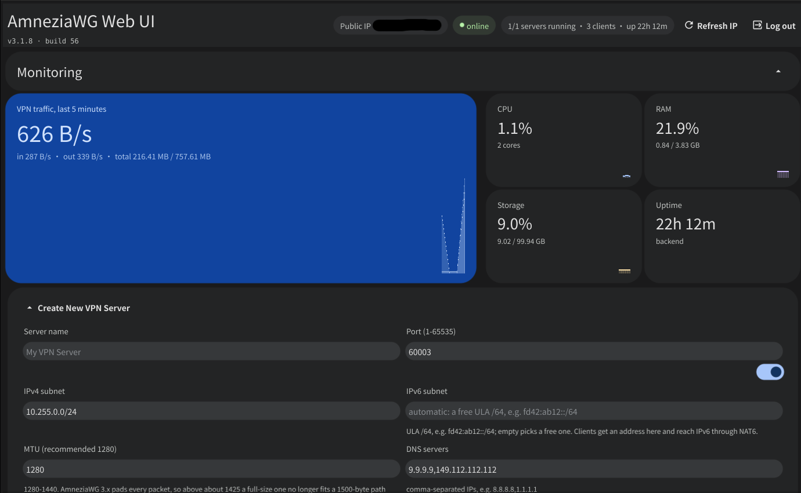

# AmneziaWG Web UI — a self-hosted admin panel for AmneziaWG VPN in Docker

[](https://github.com/noelbennettz/amneziawg-ui/pkgs/container/amneziawg-ui)
[](https://noelbennettz.github.io/amneziawg-ui/)
[](go.mod)
[](DOCS.md#amneziawg-31--the-essentials)
[](LICENSE)

**AmneziaWG Web UI** is a web panel for **AmneziaWG**, the obfuscated fork of
WireGuard that gets past DPI blocks on VPN traffic. One container holds the
panel and the VPN servers it manages: create servers, add clients, hand out a
`.conf` file, a QR code or a `vpn://` link for the AmneziaVPN app, and watch
traffic and handshakes in the browser. It is a single Go binary with a
WebAssembly front end, about 35 MB, no Node.js, nginx or supervisor, licensed
AGPL-3.0. AmneziaWG 3.1 (header protection, random trailers, cookies disabled)
is on for every server, with nothing to configure by hand.

<p align="center">
  
</p>

## Requirements

- A Linux host with Docker Engine and Docker Compose **2.24 or newer** (the compose files use `env_file.required` and `!reset`).
- A public IPv4 and/or IPv6 address. IPv6 per server is optional, but a bridge network gives clients an IPv6 tunnel without IPv6 egress — see [DOCS.md](DOCS.md#ipv6-and-nat6).
- Host ports `54845/tcp` (panel) and `54844/udp` (the first VPN server), or your own values.
- `/dev/net/tun` on the host. The tunnel runs in user space (`amneziawg-go`), so no kernel module and no `SYS_MODULE`.

## Quick start

```bash
git clone https://github.com/noelbennettz/amneziawg-ui.git
cd amneziawg-ui
cp .env.example .env
printf 'your-password' | openssl dgst -binary -sha256 | base64   # paste into WEB_UI_PASSWORD
docker compose up -d
```

`docker compose up -d` pulls `ghcr.io/noelbennettz/amneziawg-ui:latest` and
starts it; `.env` is optional, and leaving it out keeps the defaults. Open
`http://<server-ip>:54845`, sign in as `admin` with the password you hashed,
then **Create server → Add client** and take the `.conf`, the QR code or the
`vpn://` link. Update with `docker compose pull && docker compose up -d`.

The container does not terminate TLS. Restrict port `54845` with a firewall or
put a TLS proxy in front of it before exposing it — the
[FAQ](DOCS.md#do-i-need-https-and-how-do-i-enable-it) has the two settings that
matter behind a proxy.

## Documentation

| Document | Contents |
| --- | --- |
| [DOCS.md](DOCS.md) | Features, AmneziaWG 3.1 parameters, IPv6 and NAT6, REST API, environment variables, compose variants, building from source, profiling, logs, backup and restore, security details, FAQ |
| [SECURITY.md](SECURITY.md) | What the panel assumes, what it does not protect against |
| [`docs/`](docs/) | Project site, deployed to <https://noelbennettz.github.io/amneziawg-ui/> |
| [`.env.example`](.env.example) | Every environment variable with its default |
| [`docker-compose.example.yml`](docker-compose.example.yml) | The same service with every compose key and variable commented |

Dated image tags, one per build, are listed under
[Releases](https://github.com/noelbennettz/amneziawg-ui/releases); pinning one
turns an upgrade into a decision.

## Licence

**[AGPL-3.0](LICENSE)**, and section 13 is the operative part: run a modified
panel as a network service and its users get the source of the version you run.
Self-hosting, forking and selling support are fine; withholding your changes
from the people using them is not.
