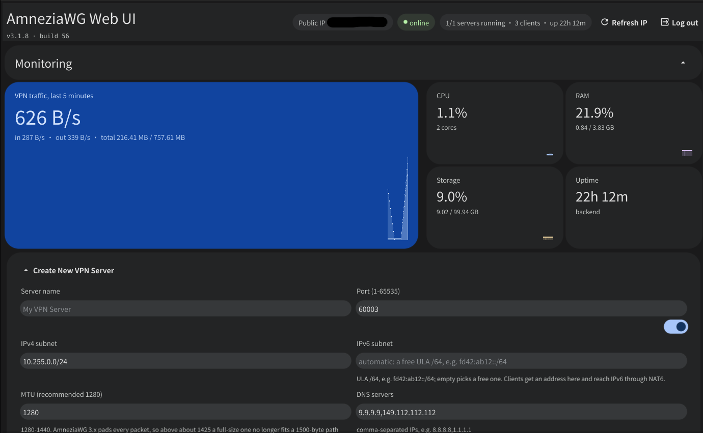

# AmneziaWG Web UI — a self-hosted admin panel for AmneziaWG 3.1 VPN in Docker

[](https://github.com/noelbennettz/amneziawg-ui/pkgs/container/amneziawg-ui)
[](go.mod)
[](DOCS.md#-amneziawg-31--the-essentials)

**AmneziaWG Web UI** is a self-hosted admin panel for **AmneziaWG** — the
obfuscated fork of **WireGuard** that gets past DPI blocks on VPN traffic. One
`docker compose up -d` and you have your own VPN server with a browser panel:
create several AmneziaWG servers, add clients, hand out configs as a `.conf`
file, a QR code or a `vpn://` link for the **AmneziaVPN** app, and watch traffic
and connections in the browser. Amnezia Panel.

It is a lightweight alternative to `amnezia-wg-easy` and `wg-easy`: a single Go
binary plus three AmneziaWG binaries in an Alpine image of about **35 MB**
([amnezia-wg-easy](https://github.com/w0rng/amnezia-wg-easy) is ~80 MB) — no
Node.js, no nginx, no supervisor. **AmneziaWG 3.1 (header protection + random
trailers) is built in and always on**, nothing to configure by hand.

<p align="center">
  
</p>

> **AmneziaWG Web UI** is a self-hosted admin panel (web UI) for AmneziaWG.
> A single ~35 MB Docker image (Go + Alpine) to create VPN servers, manage
> clients, export `.conf` files, QR codes and AmneziaVPN `vpn://` links, and
> watch traffic — with AmneziaWG 3.1 obfuscation (header protection, random
> trailers) always on. The UI is available in English, Russian, French,
> Spanish and Chinese (both scripts); the documentation is in English.

## Contents

- [Features](#features)
- [Quick start: AmneziaWG in Docker in one minute](#quick-start-amneziawg-in-docker-in-one-minute)
- [Updating](#updating)
- [Environment variables](#environment-variables)
- [FAQ](#faq)
- [License](#license)
- [Documentation](#documentation)
- [Changelog](#changelog)

## Features

- **Several AmneziaWG VPN servers** on one host, each with its own port,
  subnet, MTU, DNS, endpoint and obfuscation parameters
- **AmneziaWG 3.1 by default**: header protection, random trailers, disabled
  cookies, junk packets and padding — the `HeaderProtectionKey` and every
  parameter are generated automatically and kept in sync with every client
  config
- **Client management**: add, edit and delete clients, suspend and reactivate
  one without restarting the server, suspend on a schedule
- **Client config export** three ways: a `.conf` file, a **QR code** for mobile
  apps and a native **`vpn://`** link for AmneziaVPN
- **Real-time monitoring**: traffic, the last handshake and the endpoint of
  every client, and the server status — updated automatically
- **A login page in front of the panel**: the same `WEB_UI_USER` and
  `WEB_UI_PASSWORD` as before, a signed session cookie for 12 hours, and an
  `Authorization: Basic` header still accepted on every route so `curl -u` and
  existing scripts keep working. Every write also needs a CSRF token — the
  `awg_csrf` cookie echoed in `X-CSRF-Token` — unless it authenticated with that
  header, which is why a script that uses `-u` needs no change and one that
  carries only the cookie does
- **REST API** for automation: everything the web UI does is reachable over
  HTTP endpoints behind the same login as the panel
- **Auto-start of servers** after a container restart, **automatic iptables
  setup**, IPv4 and IPv6 support (the IPv6 half is a ULA /64 per server with
  NAT6). The panel itself answers on both stacks, a client config's `Endpoint`
  takes a host name or an address of either family, and the DNS list takes
  resolvers of either family too
- **UI in six languages** — English, Russian, French, Spanish, Simplified and
  Traditional Chinese; the language comes from the browser settings, and the
  login page in front of the panel follows the same rule
- **Small image**: Go + Alpine, ~35 MB, no interpreters and no extra services.
  About 13 MB of that is the Chinese font, which the panel has to carry: a
  browser canvas has no system fonts to borrow a glyph from

## Quick start: AmneziaWG in Docker in one minute

You need a Linux VPS with Docker installed. Drop a `docker-compose.yml` on the
server:

```yaml
services:
  app:
    # Every build is published as :latest and under the date it was built -
    # ghcr.io/noelbennettz/amneziawg-ui:2026.11.11 - so an upgrade can be a
    # decision instead of a restart.
    image: ghcr.io/noelbennettz/amneziawg-ui:latest
    restart: unless-stopped

    ports:
      # Host port : container port. The container listens on WEB_UI_PORT and
      # the image's health check asks 127.0.0.1 for /status, so keep the two
      # sides the same number. In front of a reverse proxy, publish on the
      # host's loopback instead: "127.0.0.1:54845:54845/tcp".
      - "54845:54845/tcp"    # the panel
      - "54844:54844/udp"    # the first VPN server; a range works too

    environment:
      - WEB_UI_PORT=54845
      - WEB_UI_USER=admin
      # base64(sha256(password)); the value below is "changeme", replace it:
      #   printf 'your-password' | openssl dgst -binary -sha256 | base64
      - WEB_UI_PASSWORD=BXugPWxEEEhj3HNh/kV4ll0YhzYPkKCJWILlimJI/IY=
      # Behind a proxy that terminates TLS, the container still sees plain
      # HTTP: say so, or the cookies go out without Secure.
      # - WEB_UI_SECURE_COOKIE=true
      # Logins, logouts and every change through the API, one JSON object per
      # line, in /etc/amnezia/audit.log. Off unless asked for; entries are
      # kept for a day, or for WEB_UI_AUDIT_RETENTION_HOURS (1..720).
      # - WEB_UI_AUDIT_LOG=true
      # - WEB_UI_AUDIT_RETENTION_HOURS=24
      # Only for network_mode: host. With published ports, leave it unset -
      # Docker forwards to the container's address, not to its loopback.
      # - WEB_UI_BIND=127.0.0.1

    volumes:
      # Servers, client configs and web_config.json. Back this up and the
      # panel moves to another host as it is.
      - data:/etc/amnezia

    cap_add:
      # iptables, interfaces and routes: that is all the panel needs. The
      # tunnel runs in userspace (amneziawg-go), so no kernel module is
      # loaded and SYS_MODULE is neither needed nor granted.
      - NET_ADMIN
    devices:
      - /dev/net/tun

    sysctls:
      # Forwarding for the tunnel. The IPv6 pair is what lets a client get a
      # ULA address; the container still needs an IPv6 uplink of its own
      # before anything can be routed out of it - see DOCS.md.
      - net.ipv4.ip_forward=1
      - net.ipv4.conf.all.src_valid_mark=1
      - net.ipv6.conf.all.disable_ipv6=0
      - net.ipv6.conf.all.forwarding=1
      - net.ipv6.conf.default.forwarding=1

    logging:
      # The panel's own log is one line per request; client configs are
      # responses, never logged, so this stays small.
      options:
        max-size: 10m
        max-file: 3

volumes:
  data:
```

The image carries its own `HEALTHCHECK` (it asks the panel for `/status`
every 30 s), so `docker compose ps` shows `healthy` without anything in the
file above. It runs as root on purpose: `awg-quick` and `iptables` are what
the panel drives, and both need it inside the container's network namespace.

And bring it up with one command:

```sh
docker compose up -d
```

> [!NOTE]
> The image is published to GitHub Container Registry as
> `ghcr.io/noelbennettz/amneziawg-ui`. A freshly created package is **private**:
> either make it public once under *Package settings → Change visibility* or run
> `docker login ghcr.io` (with a personal access token that has `read:packages`)
> on the host before pulling.

> [!IMPORTANT]
> The port mapping reaches the container over IPv6, but the container itself has
> no IPv6 address on the default bridge network — so clients get an IPv6 tunnel
> and no IPv6 internet through it. For real IPv6 egress run the service with
> `network_mode: host` (the two `net.ipv6.conf.*` sysctls then belong on the
> host) or give the Docker network a routed global IPv6 prefix. `GET
> /api/system/iptables-test?server_id=…` reports whether an IPv6 default route
> and a global IPv6 address are seen from inside.

The admin panel is at `http://<your-server>:54845`: a login page asks for the
user `admin` and the password `changeme`, and the session it hands out lasts 12
hours. Change the password before you open the port to the internet.

> [!IMPORTANT]
> `WEB_UI_PASSWORD` holds **base64 of the SHA-256 of the password**, not the
> password itself:
> ```sh
> printf 'your-password' | openssl dgst -binary -sha256 | base64
> ```
> The container does not terminate TLS. If you need HTTPS, put your own reverse
> proxy in front of it (nginx, Caddy, Traefik).

Then, in the browser: **Create server** → the AmneziaWG server is up →
**Add client** → download the `.conf`, scan the QR code or copy the `vpn://`
link into the AmneziaVPN app.

## Updating

Pull the fresh image and recreate the container — from the same directory the
`docker-compose.yml` lives in:

```sh
docker compose pull
docker compose up -d
```

Every build is also published under the date it was made (`…:2026.11.11`), so
the line above can be a decision instead of a habit: put that tag in the compose
file and nothing moves until you change it.

The servers, the clients and `web_config.json` live in the `/etc/amnezia` volume
and updating does not touch them; after the start the container brings the
servers created earlier back up on its own. VPN clients reconnect
automatically. The old image can be removed with `docker image prune` (only if
you know what that command does).

An open browser tab from the previous version keeps reading, but its writes are
refused until the page is reloaded: the panel expects a CSRF token that the old
bundle never sends, and a reload fetches the current one — the asset names do not
change, so there is no cache to clear.

> [!TIP]
> Before updating, have a look at [CHANGELOG.md](CHANGELOG.md) — changes that
> need an action on your side are called out there.

## Environment variables

All of them only set **defaults** — almost everything can be overridden per
server through the UI or the API. The exception is `WEB_UI_*`, which is read
only at startup.

| Variable | Default | Description |
|---|---|---|
| `WEB_UI_PORT` | `54845` | Web UI port. The same value is baked into the image and published in compose |
| `WEB_UI_BIND` | *every address* | Address the panel binds **inside the container**. Leave it alone when the port is published in compose — Docker forwards to the container's address, not to its loopback, so `127.0.0.1` there makes the published port unreachable. It is for `network_mode: host`, where there is no port mapping and the process has to keep to the host's loopback itself |
| `WEB_UI_USER` | `admin` | Login name for the panel and for `curl -u` |
| `WEB_UI_PASSWORD` | `changeme` | Login password as base64 of its SHA-256 (see the box above) |
| `WEB_UI_SECURE_COOKIE` | *auto* | Force the `Secure` flag on the cookies: `true` behind a TLS proxy that does not send `X-Forwarded-Proto`, `false` to pin it off. Unset follows the request and that header |
| `WEB_UI_AUDIT_LOG` | `false` | Append logins, logouts and every change made through the API to `/etc/amnezia/audit.log`: time, address, user, route, status. Off by default — it records who reached the panel |
| `WEB_UI_AUDIT_RETENTION_HOURS` | `24` | How long an entry stays in that file before it is dropped: at least `1`, at most `720` (30 days). Swept once an hour, and the file is rewritten only when something has aged out |
| `WEB_UI_PPROF` | `false` | Profiler at `/debug/pprof` behind the same login. Parsed as a boolean (`1`, `true`, `t`), anything else is off |
| `AUTO_START_SERVERS` | `true` | Bring servers up automatically: when the container starts, and for one created in the panel |
| `DEFAULT_MTU` | `1280` | Default MTU for new servers |
| `DEFAULT_SUBNET` | `10.0.0.0/24` | Default subnet for new servers |
| `DEFAULT_PORT` | `54844` | Default UDP port for new servers. This is the one published in compose |
| `DEFAULT_DNS` | `8.8.8.8,1.1.1.1` | DNS servers written into client configs |

All state — the server configs and `web_config.json` — lives in the
`/etc/amnezia` volume. Back that volume up and the panel moves to another
machine as it is.

## FAQ

### How is AmneziaWG different from WireGuard?

AmneziaWG is a fork of WireGuard with traffic obfuscation: junk packets,
padding and altered headers keep DPI from recognising the protocol. AmneziaWG
3.0 added **header protection** — encrypting the WireGuard packet header
itself — and 3.1 added **random trailers** and disabled the cookie exchange.
Speed and cryptography are the same as WireGuard. More in
[DOCS.md](DOCS.md#-amneziawg-31--the-essentials).

### Which clients can connect to an AmneziaWG 3.1 server?

The official **AmneziaVPN 5.0.1.5 or newer** app for Windows, macOS, Linux,
Android and iOS — paste the `vpn://` link into it or scan the QR code. For
older clients, clear `RandomTrailers` and `DisableCookies` in the server form:
the rest of the AmneziaWG 3.x parameters are compatible with them.

### How do I change the admin panel password?

The password is stored in `WEB_UI_PASSWORD` as base64 of its SHA-256. Compute
the new value with
`printf 'your-password' | openssl dgst -binary -sha256 | base64`, put it into
`docker-compose.yml` and restart the container. The session cookie is signed
with a key derived from the credentials, so a restart keeps everyone logged in,
while changing the password ends every session at once.

### How do I back up and move the VPN to another server?

All the state lives in the `/etc/amnezia` volume: `web_config.json`, the `.conf`
of every server, and `audit.log` if you turned the audit log on. Copy it
(`docker cp <container>:/etc/amnezia ./backup/`), restore the volume on the new
machine and start the container — servers and clients come up as they were.

### Do I need HTTPS, and how do I enable it?

The panel serves HTTP: the login page sits in front of every route except
`/status`, and only that page posts the credentials, so no browser password
prompt appears. Behind a proxy that terminates TLS the container sees plain
HTTP, so set `WEB_UI_SECURE_COOKIE=true` — or leave it unset and have the proxy
send `X-Forwarded-Proto: https`, which the panel follows when the variable is
not set.

With a proxy on the same host, publish the port on the host's loopback
(`"127.0.0.1:54845:54845/tcp"`) rather than setting `WEB_UI_BIND`: inside a
bridge network the container has to listen on its own address for the mapping
to reach it. `WEB_UI_BIND=127.0.0.1` is for `network_mode: host`, where there is
no mapping at all.

For access from the internet, put a reverse proxy with TLS in front of it
(Caddy, nginx, Traefik) or restrict port `54845` with a firewall.
[SECURITY.md](SECURITY.md) says what the panel does and does not protect
against.

## License

**[AGPL-3.0](LICENSE)**. Section 13 is the point of it: if you run a modified
panel as a network service, its users get the source of the version you run.
Self-hosting, forking and selling support are all fine; closing your changes off
from the people using them is not.

## Documentation

Full description — the REST API, the reference of the AmneziaWG 3.1
obfuscation parameters (`Jc`, `Jmin`, `Jmax`, `S1`–`S4`, `H1`–`H4`,
`HeaderProtectionKey`, `RandomTrailers`, `DisableCookies`, `I1`–`I5`), IPv6 and
NAT6, the architecture, building from source, profiling, backups and debugging:

**[DOCS.md](DOCS.md)**

## Changelog

**[CHANGELOG.md](CHANGELOG.md)**

---

*Keywords: AmneziaWG, AmneziaWG 3.1, Amnezia VPN, WireGuard, DPI bypass, VPN
blocking bypass, self-hosted VPN, AmneziaWG web panel, AmneziaWG admin panel,
WireGuard web UI, VPN in Docker, docker compose VPN, amnezia-wg-easy, wg-easy,
Go, Fiber, Fyne, WebAssembly.*
